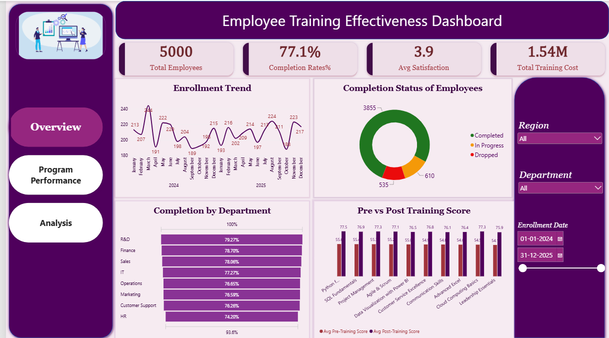
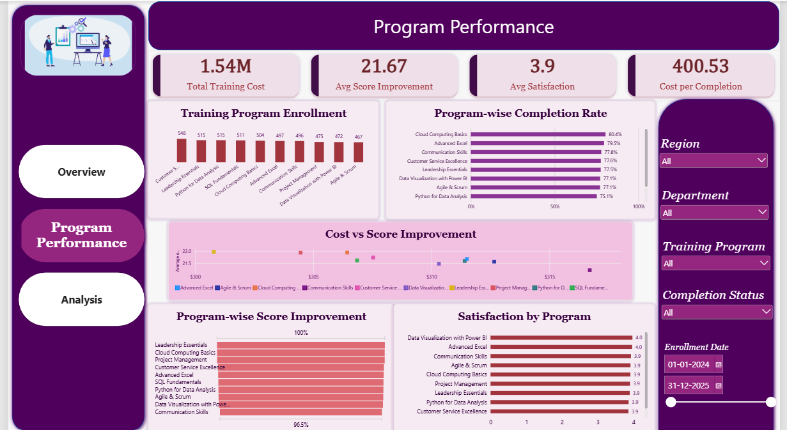
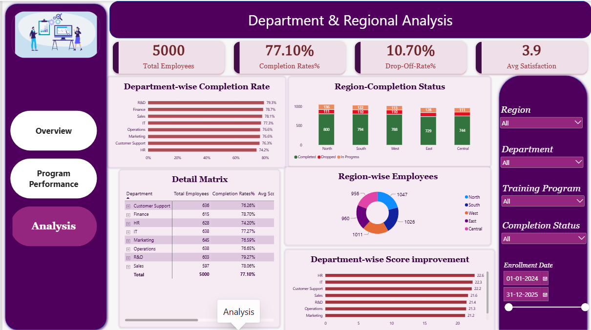

# 📊 **Training Effectiveness Analysis – Power BI Dashboard**

## 📌 **Project Overview**

The **Training Effectiveness Analysis Dashboard** is a Power BI project designed to analyze employee training programs and evaluate their effectiveness.

The dashboard helps organizations understand employee training performance by tracking completion rates, score improvements, employee satisfaction, and training costs.

The main objective is to identify successful training programs, monitor employee participation, and support better Learning & Development (L&D) decisions.

## 🎯 **Project Objectives**

- Measure the effectiveness of employee training programs.
- Analyze employee training completion and drop-off rates.
- Compare pre-training and post-training assessment scores.
- Evaluate employee satisfaction across training programs.
- Analyze training costs and identify cost-effective programs.
- Identify departments and regions that need improvement.

## 📂 **Dataset Description**

The dataset contains **5,000 employee training records** with 10 columns.

| Column | Description |
|---|---|
| EmployeeID | Unique employee identifier |
| Department | Employee department |
| Region | Employee region |
| TrainingProgram | Training course name |
| EnrollmentDate | Training enrollment date |
| CompletionStatus | Completed, In Progress, Dropped |
| PreTrainingScore | Assessment score before training |
| PostTrainingScore | Assessment score after training |
| TrainingCost_INR | Training cost per employee |
| SatisfactionRating | Employee satisfaction rating (1–5) |

**Dataset Information:**
- Total Records: 5,000
- Total Columns: 10
- Departments: 8
- Regions: 5
- Training Programs: 10
- Date Range: 2024–2025

## 🛠️ Tools & Technologies

- **Power BI Desktop** – Dashboard development and visualization
- **Power Query** – Data cleaning and transformation
- **DAX** – Calculated columns and measures
- **Microsoft Excel / CSV** – Dataset handling

## 📈 Dashboard Pages & Visualizations

The Power BI report contains three pages.

### 1. Overview

Provides a summary of overall employee training performance.

Visualizations:
- Enrollment Trend
- Completion by Department
- Completion Status of Employees
- Pre vs Post Training Score

### 2. Program Performance

Focuses on comparing the performance of different training programs.

Visualizations:
- Program-wise Score Improvement
- Program-wise Completion Rate
- Satisfaction by Program
- Training Program Enrollment
- Cost vs Score Improvement

### 3. Analysis

Provides detailed analysis across departments and regions.

Visualizations:
- Department-wise Completion Rate
- Department-wise Score Improvement
- Region-Completion Status
- Region-wise Employees
- Detail Matrix

## 🧮 Calculated Columns

The following calculated columns are used in the project:

**1. Score Improvement**
- Calculates the difference between post-training and pre-training scores.
- Helps measure employee learning progress.

**2. Enrollment Month**
- Extracts the month and year from the enrollment date.
- Used for monthly enrollment analysis.

**3. Outcome Flag**
- Categorizes employee training outcomes into On Track, At Risk, and In Progress.

**4. Cost Bucket**
- Groups training costs into Low, Medium, and High categories.

## 📊 Key DAX Measures

The project uses DAX measures to calculate important business metrics.

| Measure | Purpose |
|---|---|
| Total Employees | Calculates total unique employees |
| Completed Employees | Counts employees who completed training |
| Completion Rate % | Calculates the overall training completion percentage |
| Avg Score Improvement | Measures average improvement in assessment scores |
| Avg Satisfaction | Calculates average employee satisfaction |
| Total Training Cost | Calculates total training expenditure |
| Cost per Completion | Calculates the average cost per completed employee |
| Drop-off Rate % | Measures the percentage of employees who dropped out |

## 🔍 Key Insights

Based on the analysis of the 5,000 employee training records:

- **77.1% Overall Completion Rate:** Most employees successfully completed their training programs.
- **+21.67 Points Average Score Improvement:** Training programs showed positive improvements in employee assessment scores.
- **3.9/5 Average Satisfaction:** Employees reported a generally positive training experience.
- **₹1.54M Total Training Spend:** Represents the total investment in employee training.

### Additional Findings

1. Leadership Essentials and Cloud Computing Basics achieved the highest average score improvements.
2. R&D and Finance departments recorded the highest completion rates, while HR had the lowest.
3. Employees who dropped out reported lower satisfaction compared to employees who completed training.
4. Customer Service Excellence, Leadership Essentials, and Python for Data Analysis were among the most enrolled training programs.

## 💡 Business Recommendations

- Review HR training schedules to improve employee participation and completion.
- Identify reasons behind employee drop-offs and improve early engagement.
- Continue investing in training programs that deliver higher learning improvements.
- Monitor training expenditure to identify cost-effective programs.
- Improve employee satisfaction through better training experiences.

## 📁 Project Files

| File | Description |
|---|---|
| `TrainingEffectiveness.pbix` | Power BI dashboard report |
| `Training_Effectiveness_PowerBIDashboard.pptx` | Project presentation |
| `training_effectiveness_data.csv` | Project dataset |
| `TrainingEffectiveness.pdf` | Exported pdf file |
| `Readme.md` | Project overview |

## 🚀 How to Use This Project

1. Download or clone this repository.
2. Open `TrainingEffectiveness.pbix` using Power BI Desktop.
3. If prompted, update the dataset source path.
4. Refresh the data if required.
5. Explore the three dashboard pages using the available filters and visualizations.

## 📷 Dashboard Preview

## 🎓 Project Outcome

This project demonstrates practical knowledge of Power BI, data cleaning, data modeling, DAX calculations, and interactive dashboard development.

It provides insights into employee training effectiveness and helps organizations make data-driven decisions regarding training investments and employee development.

---

**Project Type:** Data Analytics | Business Intelligence

**Tool:** Microsoft Power BI

**Author:** Anjana P C
